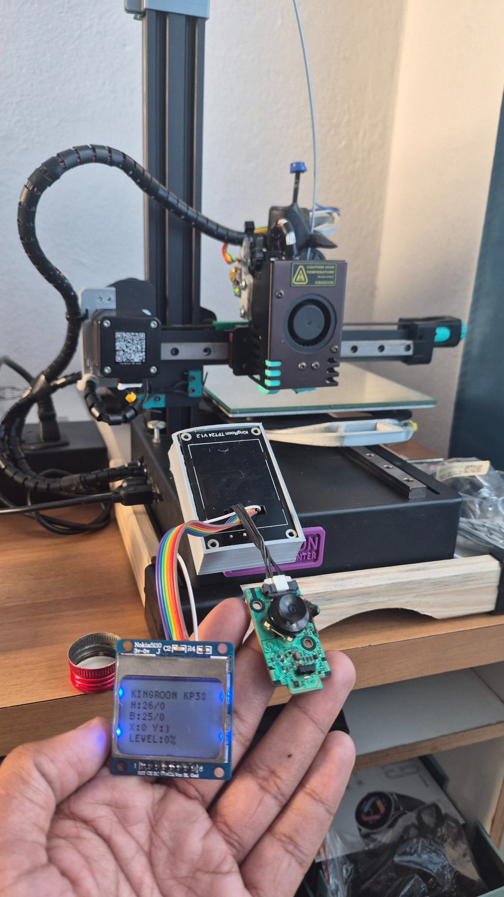

# Kingroon KP3S Marlin Firmware

Firmware generator and host utilities for a **custom Kingroon KP3S** with a **Nokia 5110 / PCD8544 LCD** and **Samsung UE5000 / BN41-01840B control board**. Based on pinned Marlin 2.1.3-b3 sources.

> **Hardware-specific project — not a drop-in firmware for a factory KP3S.** Verify the exact STM32F103VE board revision, all wiring and the thermal sensor before building or flashing. This repository ships **source and build tools, not a hardware-validated `.bin`**.



## What it includes

- Nokia 5110 (84 × 48) menu and Samsung UE5000 navigation (keys, IR receiver and LED).
- Multi-language menus, adjustable display orientation, brightness and screen timeout.
- Optional BLTouch, filament runout, up to two MPU6050 sensors and resonance-assisted Input Shaping.
- Marlin motion features: Linear Advance, firmware retract, Z babystepping, PID tuning and G2/G3 arcs.
- SD printing, power-loss recovery support (disabled by default), extended G-code reports, macros and USB diagnostics.
- Windows and Ubuntu build launchers, bounded maintenance controls and an automated offline test suite.

**Thermal selection is independent of the Nokia/Samsung control hardware:**

| Internal hotend profile | Sensor expected | Maximum selectable target | Thermal cutoff |
| --- | --- | ---: | ---: |
| `stock` (default) | Marlin table 1, compatible installed sensor | 235 °C | 250 °C |
| `high-temp` (optional) | Marlin table 61, verified 100k B3950 350 °C sensor | 340 °C | 350 °C |

The `high-temp` firmware **requires an independently verified, 350 °C-capable all-metal hotend, thermistor, heater, wires and connectors**. Changing a firmware parameter cannot upgrade physical hardware. High-temperature generation requires explicit confirmation; no temperature rating is established by automated tests. Read [thermal and control profiles](docs/control-profile.md).

## Quick start

Requires **Python 3.10+**. Firmware compilation additionally requires internet access to the pinned Marlin sources and PlatformIO toolchains. The serial utilities use the optional dependency in `firmware/requirements.txt`.

```bash
# Validate generator structure and run offline tests (no printer needed)
python3 firmware/build_firmware.py --audit-only
python3 firmware/selftest.py

# Ubuntu / Linux: interactive build for the custom Nokia/Samsung KP3S
bash firmware/BUILD_FIRMWARE.sh

# Non-interactive stock-compatible profile build
python3 firmware/build_firmware.py --build --auto-toolchain --hotend-profile stock

# Discover available diagnostic/maintenance actions (does not connect)
python3 firmware/kp3s_console.py --list-actions
```

On Windows, use `firmware\BUILD_FIRMWARE.bat` from a terminal or File Explorer. To check Python startup and the internal thermal profile without downloading Marlin, run `firmware\BUILD_FIRMWARE.bat --show-default-profile`. For the upgraded hotend, read the full [build and flash guide](docs/build-and-flash.md) **before** selecting `high-temp`.

The internal setting is in [`firmware/kp3s_project_config.py`](firmware/kp3s_project_config.py):

```python
CONTROL_HARDWARE_PROFILE = "nokia5110-samsung-ue5000"
DEFAULT_HOTEND_PROFILE = "stock"  # Or "high-temp" with verified hardware
```

**Do not change the control profile to the factory touchscreen.** The pin map and safety checks target this specific custom assembly. See [pinout](docs/pinout.md) and [Samsung wiring](docs/samsung-control-board.md).

After a **successful real compile**, the firmware output is expected at `firmware/firmware_output/FLASH_KP3S/Robin_nano.bin`; hashes and a build manifest are also generated. Neither this file nor a verified flash image is included in the repository. The GitHub Actions offline checks are **not** evidence of a successful C++ build or working electronics.

## Repository layout

```text
firmware/             Marlin generator, project settings, serial tools and self-tests
assets/               Custom-panel photos and wiring diagrams
docs/                 Hardware references, feature guides and validation matrix
.github/workflows/     Automated offline checks and optional manually triggered build
```

## Documentation

- [Hardware profile and internal thermal switch](docs/control-profile.md)
- [Pinout and wiring](docs/pinout.md) · [Samsung controller](docs/samsung-control-board.md)
- [Build, flash and first checks](docs/build-and-flash.md)
- [Firmware capabilities](docs/firmware-v1.md) · [extended G-code controls](docs/enhanced-firmware.md)
- [Runtime USB console](docs/runtime-console.md) · [Serial transfer](docs/serial-print.md)
- [MPU6050](docs/mpu6050.md) · [Resonance tuning](docs/resonance-tuning.md) · [BLTouch](docs/bltouch.md)
- [Validation status and limitations](docs/validation.md) · [Hardware acceptance matrix](docs/test-matrix.md)
- [Contribution guidelines](CONTRIBUTING.md) · [Security reports](SECURITY.md) · [Publishing checklist](docs/publishing.md)

## Verification and safety status

The **119 offline Python tests** and generator structural audit passed in the preparation environment. These tests exercise Python tools, build orchestration with mocks and simulated serial responses. **Actual Marlin C++ compilation, flash size, bootloader compatibility and physical operation have not been verified here.** Do not present the source package as tested firmware for end users; perform the supervised [hardware acceptance checks](docs/test-matrix.md) before any unattended use.

## Licensing

Licensed under [GNU GPL v3](LICENSE). The project uses and modifies the GPL-licensed [Marlin](https://github.com/MarlinFirmware/Marlin) firmware downloaded during generation; it is not affiliated with Marlin, Kingroon, Nokia or Samsung. Review the asset ownership and upstream notices before republishing; see [NOTICE.md](NOTICE.md).
